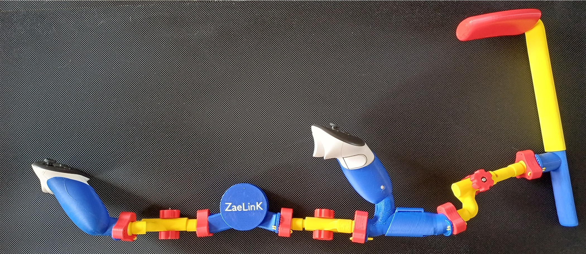
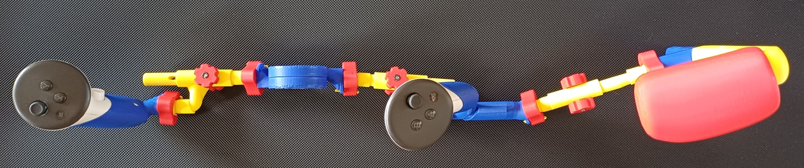
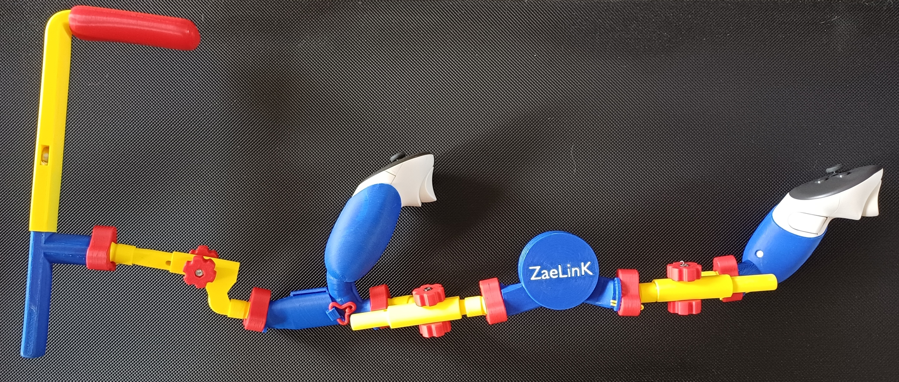

#This is the Zaelink VR Gunstock 
First pictures shows it in Quest 3 Configuration, Detachable Buttstock  and adjustable in leght connecting rods (Olympic version). No Buttstock and Fixed Buttstock versions are also available (details bellow). 

Left side view:

Top down view:

Right side view:

  
In this next picture we have the gunstock disasembled in its main component parts:  

  
The components of the Zaelink VR Gunstock are:  
  
**1.** The main component is the **Magnetic Core** that efectively makes the connection between the two VR motion controllers user operates in realistic VR shooter type games or experiences.  

This Core is comprised of two round halves connected via connecting rods to the VR Touch Controllers. Inside the two circular halves that resembles to very flat cilinders facing eachother vertically there are a pattern of (usually) 6 (six) button type magnets (15x6mm or smaller thickness for adjusting magnetic power) arranged in a hexagonal pattern where each center of every magnet finds itself on a corner of this hexagonal imaginary shape that defines its pattern. The distance between magnets can also be tweaked but the Zaelink VR Gunstock uses a fixed 5cm lenght for any hexagon edge as it was found to be optimal for this application.  
The two halves of the Magnetic Core thus attract each other by magnetic means while in close proximity aligning themselves with each of the six magnets of one side snapping to each of the six magnets of e other side. 

  
There are two principal patterns that are used:

 **FRAGNETTO** mode where 6 magnets on one side all alligned in polarity in same direction face the oppsite polarity of the 6 magnets of the other side also all aligned in polarity in same direction as described also above. This pattern allows for strong attraction and auto orientation and allignement in most cases and also a good connection. After the connection was done the two halves can be rotated one in ralation to the other by 60° steps at least twice in each direction (six steps in total for 360° but practically maximum 3 can be done before mechanical limits stop any rotation or force disconnection). After each rotation step the connection will stay ON being only weakened during translation. This weakening moment in translation is also a moment that can be exploited by the user to quickly disconnect the two halves by rotating them and as the rotation step is half way pulling the two halves apart. The tisconnection can be done also by a more ferm longitudinal twist and pull away. It also makes possible the disconnection in case of too much force pulling in wrong directions in case of accidents. This is part of self safety of the gunstock. Either the Core magnetic connection will fail or the adjustable ball socket joints will start to give before something breaks. Ofcourse in extreme cases some parts can fail as they are made of plastic.

         **-OLYMPIC mode where 6 magnets of one side face only 4 magnets on the opposite side. The first halve with six magnets  has them aligned  3+3, meaning 3 consecutive magnets are magnetically aligned facing one direction and the other 3 (also consecutive) are manetically aligned facing the opposite direction. I.E. If looking at one circular side of one halve we would have our pattern of 6 magnets 3 facing us with the North pole and 3 facing us with the South pole. The second halve has only 4 magnets placed in pairs separated by two empty corners of our hexagonal pattern. One pair of magnets is alligned while facing same direction among themselves with the opposite polarity of the magnets found on the opposite halve so they are attracted. The other pair, likewise, is alligned in reverse facing now the oposite side of the reversed polarity of the opposite 3 magnets on the opposite halve. Two (opposite) corners of the hexagonal pattern of this second halve are thus left empy As we can see in this configuration the atraction is mainly produced among 4 pairs of magnets as opposed of 6 in the other mode, however due to the empty places the attraction is cleaner and almost has the same power. However this type of connection has some potential advantages:

**1. As we rotate through our steps as described above after a first step that might make the magnets jump from 4 pair magnet connection (attraction) to the second possible 4 pair magnet conection (attraction) the second step has only a 2 pair magnet attraction and 2 pair of magnet repulsion as now two of the pairs are facing each other with same polarity. At this moment the magnetic atraction between the two halves is practically zero and because of the way magnetism works in detail even a small repulsion is detected and this position facilitates a very fast disconnection between the two halves with minimum effort from the used**

**2. Using only 10 magnets instead of 12 weight and costs are saved.**

  
  
       The two halves rotate on a Pivot Pin or Gudgeon or Trunnion and its  Bore or Blind Hole or Socket type hole  that has the form of a cylinder with a semisphere on top. The cylindric part allows rotation while the connection is established and the round semisphere allows for easy slide in while the connection is being established and the two halves might not be completely alingned yet. When the connection is established this Pivot Pin and Bore assembly prevets the two halves from sliding over each other as the magnetic attraction between the pairs of magnets are not strong enough to block them from doing that during user operations. This way the connection between the two halves is strong and stable by both means of magnetism and mechanical resistance.

**2. **The second component is **the pair of Two Cups** that hold the actual VR Touch Controllers in the case of modern VR heassets like Meta Quest 3, 3S and Pro (Quest 2 works with same cups as 3), Pico 4 Ultra and in the short future Steam Frame controllers. For Pico 4 non Ultra the controllers instead of cups under rings clamps are used to latch on the controllers spiral rings from underneath avoiding occlusion of the IR tracking LEDs

The cups are designed such the controllers can slide in with ease and also mechanically be retained inside them requiring a minimal force to pull them off. Also they are designed to be 3D printed in such direction that the cups and their attachments that permit the coupling to the connecting rods that link them to the magnetic core and the buttstock are very strong and resit to operating tensions due to how the layer lines pas durring printing. The same 3D printing desing measures ensures a good shape of these cups that allow them to be thin and offer good grip cvasi identical with original to the user.

  
         **3. **The third component is the **modular Buttstock** that allows shoulder contact while having a wide range of adaptability and customisation. It’s position can be adjusted in several ways by its Extendable rod the lenght can be controlled, by its Ball Socket joints its position can be tweaked lateraly and vertically, by Rotation of the extendable rod its lateral position can be further amplified. The buttstock is modular and has an attachable **Cheekrest** that offers a forth point of contact on the cheek while operating the gunstock. Further more the Cheek rest has possibility of attachmetn of a **Cheekrest Extension that ca modify the lateral position where the cheekrest contacts the face of the user.**

**Detail second picture with Buttstock showing the opposite side where the magnets are slotted in it and Cheekrest for a stronger connection **

**Second detail picture on Butstock shows its connector for the detachable variant. A variant non detachable also exists and likewise a variant where no buttstock connection exists for people that want no buttstock at all.**

**Here bellow you can see a non detachable Buttstock variant that also has non adjustable connecting rods. Their length can be chosen or modified prior to printing.  
**

**4. The fourth component is comprised of the 3 extendable or fixed in length connecting rods. These connecting rods make the connecton between the first three components. There design, 3d printing details and operation are critical to the use of the Zaelink gunstock.**

**Two type are thus provided for maximum of flexibility. The fixed ones trade the varible length for lightness and ruggedness while the extendable ones offer maximum convenience. The extendable ones are associated mostly with the Olympic mode while the fixed ones more with Fragnetto mode But this is just a paradigm alignment mostly as mixes ar etotally possible including having some connecting rods fixed and some extendable. **

**Finally 3 more pictures with some more details. First show the adjusting rods in extended position. Second and Third show a Pico 4 Ultra and respectively a Pico 4 (nonUltra) variants in Fragnetto Configuration with fixed connecting rods.**

**Pico 4 Ultra version with fixed connecting rods**

**Pico 4 non Ultra version sporting stronger knobs for rare cases of 3d printing defects.**

**  
End of document.  
**
